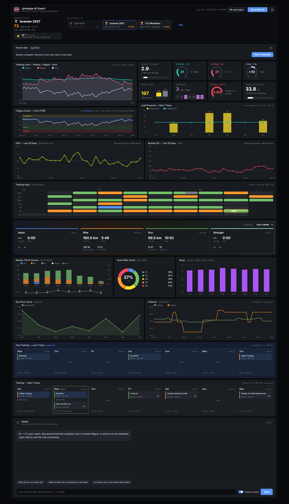
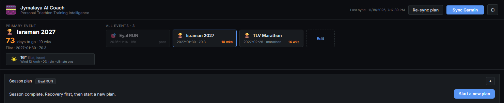
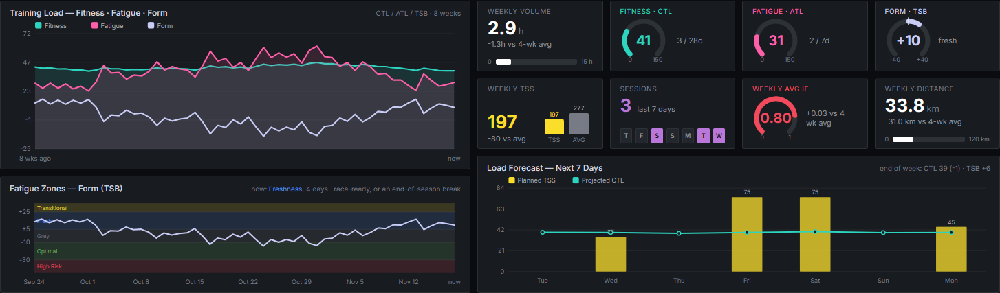
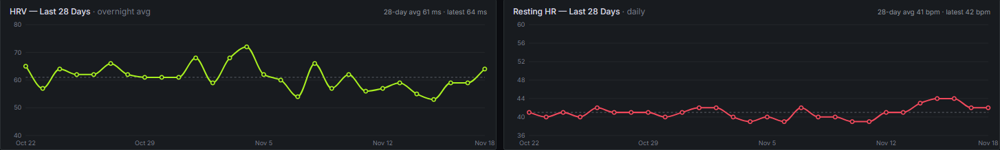
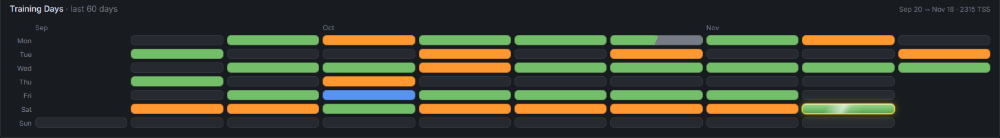
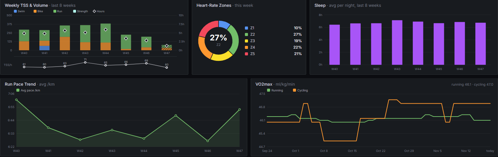
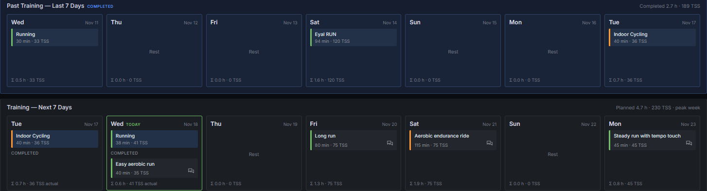
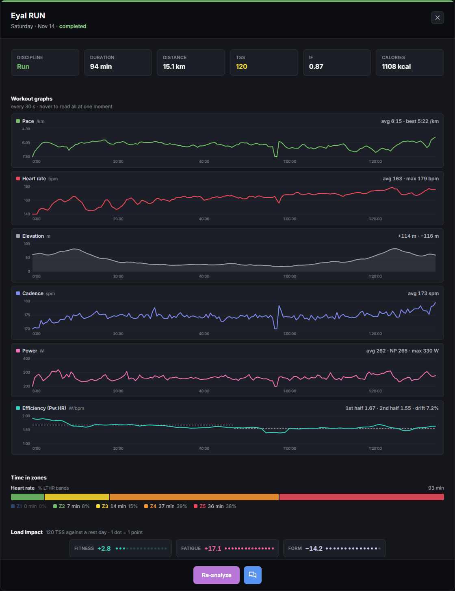
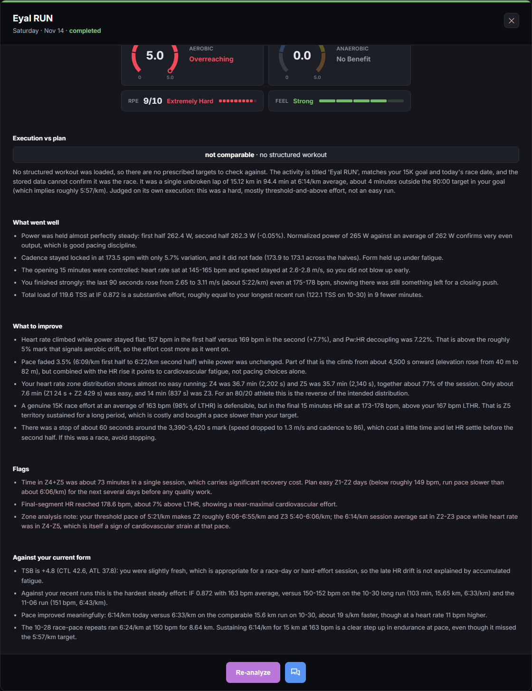
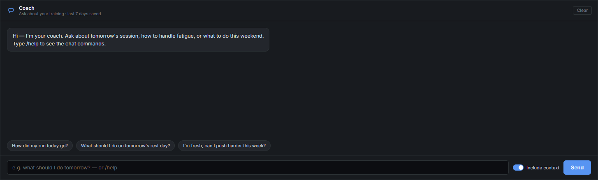

# Jymalaya AI Coach

A personal triathlon coach that runs on your own computer. Jymalaya pulls your
workouts from Garmin Connect, stores them in InfluxDB, computes training load
(TSS, fitness, fatigue, form) and uses Claude to write your next 7 days of
training. A coach chat answers questions about your training and can change
the plan for you. Everything is shown on one dashboard.

It is built for a single athlete: your data stays on your machine, and the
only outside calls go to Garmin, the Claude API, Open-Meteo (weather) and,
if you use it, intervals.icu.



## Features

### Events and the season plan
Add the races you are training for: distance, date, location, target time.
The nearest race you are taking part in becomes the primary event, with a
countdown and a race-day weather forecast. A season plan works back from that
race week by week: base, build, peak, taper and race week, with three loading
weeks followed by a recovery week. Without a race, a fitness plan checks in
with you at the end of each week and asks whether to increase, hold or
decrease the load.



### Training load
Each workout gets a TSS. Bikes use power, runs use Normalized Graded Pace
taken from the FIT file, swims use critical swim speed, and heart rate is the
fallback when none of those is available. From the TSS, Jymalaya computes
fitness (CTL), fatigue (ATL) and form (TSB) over the full stored history. The
Fatigue Zones chart draws form over Joe Friel's zones, and the load forecast
projects the next 7 days of the plan.



### Recovery and history
- HRV and resting heart rate for the last 28 days.
- Weekly sleep.
- Running and cycling VO2max.
- A 60-day grid of every training day, coloured by sport.







### The 7-day plan
After every sync, Claude writes a rolling 7-day plan. It follows your training
schedule (rest days, sessions per day, brick days), the season plan's weekly
budget, 80/20 intensity, your form, and your own standing instructions to the
coach. Rest days and the day before a race are enforced in code, not only in
the prompt.

You can drag a session to another day. The plan changes you asked for survive
the next re-plan. Send to device puts a session on your intervals.icu
calendar as a structured workout, and intervals.icu passes it on to Garmin
Connect and your watch.



### Workout details and analysis
Open a completed workout to see its graphs on one time axis: pace or speed,
heart rate, elevation, cadence, power and efficiency. The modal also shows
time in zones, its load impact, Garmin's Training Effect, and the RPE and feel
you entered on the watch. **Analyze** derives the coaching metrics in code
(decoupling, half splits, zones) and has Claude review the session against the
plan and your current form.





### Coach chat
Ask about your training. The coach sees your form, goal, profile and the full
plan. It can move, change, add or remove sessions, and after you approve it,
update your thresholds or instructions. Turn **Include context** off to ask a
general triathlon question without your data. Local commands: `/summary`,
`/last`, `/clear`, `/help`.



## How it works

```
Garmin Personal API ──> sync service ──> InfluxDB 2.9 <── FastAPI (/api) <── React dashboard
  (workouts, FIT,        (parse, split       (workouts,       |
   HRV, RHR, sleep)       bricks, TSS,         load, samples,  +── Claude API (plan, chat, analysis)
                          CTL/ATL/TSB)         events)         +── Open-Meteo (weather)
                                                               +── intervals.icu (send to device)
```

- **Backend**: Python 3.12 and FastAPI, with every route under `/api`.
- **Storage**: InfluxDB 2.9, in a bucket named `tricoach`. The cached plan,
  schedule and coach instructions are JSON files in `data/`.
- **Frontend**: React and Vite in `frontend/`. It is the only user interface.
- **AI**: the Claude API. The prompts live in `prompts/`; each race distance
  has its own periodization file there.

```
main.py              FastAPI entry point
app/                 sync, metrics, season plan, AI layer, routers
  garmin/            Personal API client, FIT decoding, parser
  metrics/           TSS, CTL/ATL/TSB, NGP, workout analysis
  season/            the season plan (builder, adaptation, check-ins)
  ai/                Claude calls and payload building
prompts/             system prompts, output formats, per-distance rules
frontend/            the dashboard
config/athlete.yaml  default athlete profile (example values)
scripts/             one-off backfills (dry run unless --apply)
tests/               pytest suite, no network or credentials needed
```

## Requirements

- Python 3.12 and Node 22, for development.
- Docker Desktop, or Docker Engine with Compose v2, for InfluxDB or the
  container stack.
- A **Garmin Personal API key**, from the "Personal API Key" page in Garmin
  Connect.
- An **Anthropic API key**.
- Optional: your Garmin email and password, used for VO2max only.
- Optional: an intervals.icu API key, used for Send to device only.

## Installation

### Development (Windows)

```powershell
git clone <this repo> jymalaya
cd jymalaya
copy .env.example .env          # fill in the keys, change INFLUXDB_TOKEN and INFLUXDB_PASSWORD
pip install -r requirements-dev.txt
cd frontend; npm ci; cd ..
.\start.cmd
```

`start.cmd` does four things:
1. Starts Docker Desktop if needed.
2. Brings up the InfluxDB container (`docker-compose.yml`).
3. Opens the backend on port 8080.
4. Opens the dashboard dev server on port 5173.

Then open `http://localhost:5173`.

To do the same by hand:

```bash
docker compose up -d influxdb
uvicorn main:app --reload --port 8080
cd frontend && npm run dev
```

### Docker (backend, dashboard and InfluxDB)

```bash
cp .env.example .env    # fill in the keys and change INFLUXDB_TOKEN / INFLUXDB_PASSWORD
docker compose -f docker-compose.deploy.yml up -d --build
```

Open `http://localhost:8080`. The `Jymalaya-C1` container serves the dashboard
at `/` and the API under `/api`. InfluxDB runs in a container of its own. The
data, settings and Garmin login live in named volumes, never in the image.

- Logs: `docker compose -f docker-compose.deploy.yml logs -f app`.
- Start over (deletes all history): `docker compose -f docker-compose.deploy.yml down -v`.

### First run
1. Open the settings gear. Enter your thresholds (FTP, LTHR, run threshold
   pace, CSS), weight, birthday and activity class, and set your training week.
2. Add your events.
3. Press **Sync Garmin**. The first sync pulls the last 60 days and then writes
   the first plan. If the VO2max login asks for an MFA code, type it into the
   dialog that opens.

## Configuration

Everything secret lives in `.env`, which is gitignored and never built into an
image. `.env.example` documents each key:

| Key | Used for |
| --- | --- |
| `GARMIN_PERSONAL_API_KEY` | workouts, HRV, resting HR, sleep (required) |
| `ANTHROPIC_API_KEY` | plan, coach chat, workout analysis (required) |
| `ANTHROPIC_MODEL`, `ANTHROPIC_COACH_MODEL` | Claude models for plan/analysis and for the chat |
| `GARMIN_EMAIL`, `GARMIN_PASSWORD` | VO2max (optional) |
| `INTERVALS_API_KEY` | Send to device (optional) |
| `INFLUXDB_*` | database connection and first-start credentials |
| `TZ`, `APP_PORT`, `LOG_LEVEL` | container settings |

You edit the athlete profile, training schedule and standing coach
instructions in the dashboard's Settings. They are saved to
`config/athlete.local.yaml` and `data/`, and both are gitignored.

## Usage

- **Sync Garmin** pulls new activities, recomputes the load and generates a
  new plan if anything changed.
- **Re-sync plan** writes a fresh plan without contacting Garmin.
- Click a planned session to see its structure, ask the coach about it, or
  send it to your watch. Click a completed workout to see its graphs and
  analysis.
- The API is documented at `http://localhost:8080/docs`.

## Tests

```bash
python -m pytest -q
```

The suite uses fakes only. It needs no network, Garmin account or API key.

## Caveats

- The Garmin Personal API key expires, somewhere between 30 days and a year
  after you create it. When it does, the dashboard asks you for a new one.
- VO2max still comes through Garmin's unofficial login, which can break or hit
  MFA without warning. Workouts do not depend on it.
- The Claude calls use your own Anthropic API key and are billed to it.
- InfluxDB must be running. Only syncing and the Claude features need
  internet access.
